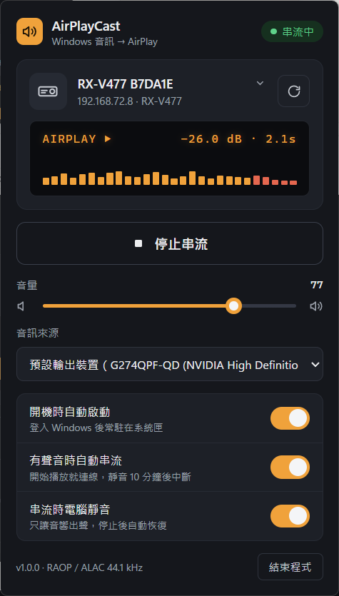
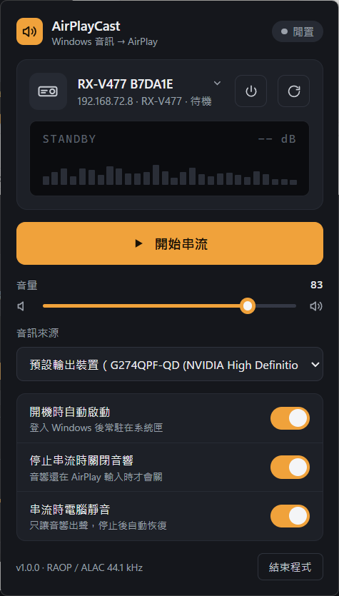

# AirPlayCast

把 Windows 正在播放的聲音，透過 AirPlay（RAOP）串流到網路上的 AirPlay 音響，例如 Yamaha RX-V477。
程式常駐在系統匣（右下角通知區域），點圖示開啟控制面板。

<p>
  
  
</p>

## 功能

- 自動搜尋區網內的 AirPlay 裝置（mDNS `_raop._tcp`），預設選 RX-V 系列
- 擷取 Windows 輸出音訊（WASAPI loopback），可選擇要擷取哪個輸出裝置
- **手動連線**：只有按「開始串流」（或系統匣右鍵選單）才會連到音響；音響會自己開機並切到 AirPlay 輸入
- **音響電源鍵**（Yamaha）：面板裝置卡片上的電源鍵、或系統匣右鍵選單可開機／關成待機
- **音響設定分頁**（Yamaha）：輸入切換、音場模式 (DSP)、Straight / Enhancer / Pure Direct、重低音加強、
  動態範圍壓縮 (Adaptive DRC)、低音 / 高音、睡眠定時；用遙控器改的設定也會同步回面板
- **停止串流時關閉音響**（Yamaha）：停止串流後，如果音響還停在 AirPlay 輸入就自動待機；已切去看電視等其他輸入則不會關
- **串流時電腦靜音**：串流期間把電腦本機喇叭靜音，停止後自動恢復（程式當掉，下次啟動也會恢復）
- 音量滑桿直接控制音響音量（可用滑鼠滾輪）。Yamaha 擴大機會改走它的網路控制 API 調主音量
  （RX-V477 預設會忽略 AirPlay 音量），用遙控器調的音量也會同步回面板。滑桿 0% = 靜音，
  1–100% 對應 -80 dB 到上限 -10 dB；上限可在設定檔的 `YamahaMaxDb` 修改
- 開機時自動啟動（登入 Windows 後常駐系統匣）
- 音響被手機等其他裝置接手時會自動放手，不會搶回來

## 安裝 / 更新

需要 .NET 10 Desktop Runtime（已隨 SDK 安裝）與 WebView2 Runtime（Windows 11 內建）。

```bash
powershell -ExecutionPolicy Bypass -File install.ps1
```

會發佈到 `%LOCALAPPDATA%\Programs\AirPlayCast`、建立開始功能表捷徑，並啟動程式。第一次啟動會自動設定開機啟動（可在面板關閉）。

> 這台電腦開著 Smart App Control，它會擋自己編譯、未簽章的 `.exe`。所以程式不產生 exe，而是用微軟簽章的
> `dotnet.exe` 載入 `AirPlayCast.dll`，外面包一層 `conhost --headless` 避免出現主控台視窗。

## 備註

- **延遲**：面板上可選 0.1 / 0.25 / 0.5 / 1 / 2 秒（預設 0.5 秒，再加上音響內部約 0.1 秒與擷取緩衝 0.02–0.08 秒）。
  2 秒是 AirPlay 1 的標準緩衝，最穩；越短越即時（看影片比較不會音畫不同步），但網路或電腦忙碌時比較容易斷音。
  串流中切換會自動重新連線。AirPlay 無法做到零延遲；需要完全同步（例如打遊戲）時，請用 HDMI 或光纖線直接接擴大機。
- 記錄檔：`%LOCALAPPDATA%\AirPlayCast\log.txt`
- 音訊以 ALAC（未壓縮框架）44.1 kHz / 16-bit 立體聲傳送；RX-V477 支援不加密模式（`et=0`），所以不需要 Apple 的金鑰。
- 解除安裝：在面板按「結束程式」，關掉「開機時自動啟動」後刪除 `%LOCALAPPDATA%\Programs\AirPlayCast`、
  `%LOCALAPPDATA%\AirPlayCast` 與開始功能表的捷徑。

## 命令列測試模式

```bash
dotnet bin/Debug/net10.0-windows/AirPlayCast.dll --console --host 192.168.72.8 --port 1025 --volume 30 --seconds 20
```

加上 `--tone` 會改送 440 Hz 測試音，`--latency 500` 可測試低延遲。

## 程式結構

| 檔案 | 用途 |
| --- | --- |
| `RaopClient.cs` | AirPlay 1 協定：RTSP 工作階段、RTP 音訊、時間同步與重傳 |
| `AlacEncoder.cs` | 產生 ALAC 未壓縮框架 |
| `LoopbackSource.cs` | WASAPI loopback 擷取、重新取樣成 44.1 kHz |
| `MdnsBrowser.cs` | mDNS 搜尋 AirPlay 裝置 |
| `StreamController.cs` | 串流狀態、本機靜音、裝置切換、音響電源與音量 |
| `YamahaControl.cs` | Yamaha 網路控制 API（電源、音量、輸入、音場模式、音效選項、睡眠定時） |
| `TrayContext.cs` / `PanelForm.cs` | 系統匣圖示與 WebView2 彈出面板 |
| `ui/index.html` | 面板介面（依 Claude Design 設計稿實作） |
| `Settings.cs` | 設定檔、開機啟動、記錄 |

## 授權

[MIT](LICENSE)
